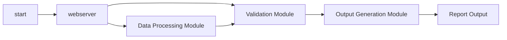

# OSACL Processor Product Requirements Document (PRD)

## 1. Introduction
### 1.1 Purpose
The purpose of this project is to make the OSCAL Catalogs usable for and
end user to modify and publish.

### 1.2 Scope
The project will include two main components:
* UI - a web-based UI runnable from a local Docker container to be able
  to render and edit the Catalog and Security Plan integrated
* Publisher - a system to redner a final integrated catalog into various
  systems such as GitHub Pages or Confluence.

The system will not include a database or other data repositories other
than standard OSCAL file types.  Mopdified files, such as the SSP,
should be able to be checked into version control.

### 1.3 Audience
The projec tis for any technically-minded compliance teams to be able to
better use OSCAL artifacts to create compliance-realted materials.

For example, a rendered OSCAL catalog could be used as the basis for
a Risk Assessment exercise.

## 2. Project Overview

### 2.1 Objectives
- develop a docker-container that starts a basic webserver, likely Python
- develop web code to render an OScal Catalog, or part of a catalog, with
  relevant substitutions from an SSP
- make the web code editable so that the system can render an SSP
- develop a rendering engine for GutHub Pages
- develop a rendering engine for Confluence

### 2.2 Success Metrics
Define how success will be measured. For example:
- Reduction in report generation time by 50%.
- 95% test coverage for all critical functions.
- User satisfaction score of 4/5 from internal stakeholders.

## 3. Functional Requirements

### 3.1 Features
List the core features of the Python project. For each feature, include:
- **Feature Name**: A short, descriptive name.
- **Description**: What the feature does and why it’s important.
- **Priority**: High, Medium, or Low.
- **Example**: 
  - **Feature**: CSV Data Parsing
  - **Description**: Parse CSV files to extract and validate data for report generation.
  - **Priority**: High

### 3.2 User Stories
Write user stories to describe how users will interact with the project. Use the format: "As a [user type], I want [functionality] so that [benefit]." For example:
- As a data analyst, I want to upload a CSV file so that I can generate a summary report automatically.

## 4. Technical Requirements

### 4.1 Technology Stack
Technologies and tools to be used:
- **Programming Language**: Python 3 Latest
- **Libraries/Frameworks**:
  - Python `http.server` for local webserver
  - `pytest` and `mock` for testing
- **Dependencies**:
  - local file-writing
  - may need intermediary SQLite database
  - GitHub Pages API
  - Confluence API
- **Environment**: 
  - Local Docker container for testing and production uses
  - Ability to run Docker container in "production" for multi-user?

### 4.2 System Architecture
Flow:
- launch docker container
- web ui loads
- if only one catalog in the directory, initalize SQLite with that catalog
- if SSP, initalize with that SSP
- load rendering engine
- render all things based on the SQLite
- Need a button to "save" the SSP to JSON/YAML file
- Need a button for publishing to other server types
  - do this with a separate script at first, specifying credentials,
    service type, catalog, ssp, etc.

Describe the high-level architecture. For example:
- Modular Python scripts with a main entry point (e.g., `main.py`).
- Separation of concerns (e.g., data processing, validation, and output generation in separate modules).
- Include a simple diagram if applicable (e.g., using Mermaid syntax for markdown).

### 4.3 Performance Requirements
Define performance expectations, such as:
- Process datasets up to 1 GB in under 5 seconds.
- Handle up to 100 concurrent users (if applicable).

### 4.4 Security Requirements
Specify security considerations, such as:
- Input validation to prevent injection attacks.
- Secure handling of sensitive data (e.g., encryption for API keys).

## 5. Non-Functional Requirements

### 5.1 Usability
Describe usability goals, such as:
- Command-line interface with clear help messages (e.g., `python main.py --help`).
- Comprehensive documentation for setup and usage.

### 5.2 Scalability
Explain how the project will handle growth, such as:
- Modular design to allow easy addition of new features.
- Support for larger datasets in future versions.

### 5.3 Maintainability
Outline practices for code maintenance:
- Follow PEP 8 style guidelines for Python code.
- Use version control (e.g., Git) with clear commit messages.
- Include automated tests using pytest.

## 6. Development Plan

### 6.1 Milestones
List key milestones with timelines. For example:
- Week 1: Set up project structure and dependencies.
- Week 2: Implement core data processing logic.
- Week 4: Complete testing and documentation.

### 6.2 Resources
Identify required resources:
- **Team**: Python developers, QA engineers, project manager.
- **Tools**: IDE (e.g., VS Code), CI/CD pipeline (e.g., GitHub Actions).
- **Budget**: If applicable, include estimated costs.

## 7. Risks and Mitigation

List potential risks and mitigation strategies. For example:
- **Risk**: Dependency version conflicts.
- **Mitigation**: Use a virtual environment and pin dependency versions in `requirements.txt`.

## 8. Documentation and Support

### 8.1 Documentation
Specify documentation deliverables:
- README with setup instructions and usage examples.
- Inline code comments for complex logic.
- API documentation if applicable (e.g., using Sphinx).

### 8.2 Support Plan
Describe how the project will be supported post-launch:
- Bug tracking via GitHub Issues.
- Regular maintenance updates every 3 months.

## 9. Appendix

Include additional information, such as:
- Glossary of terms.
- References to external resources or standards (e.g., PEP 8, Python documentation).
- Mockups or wireframes if applicable.
