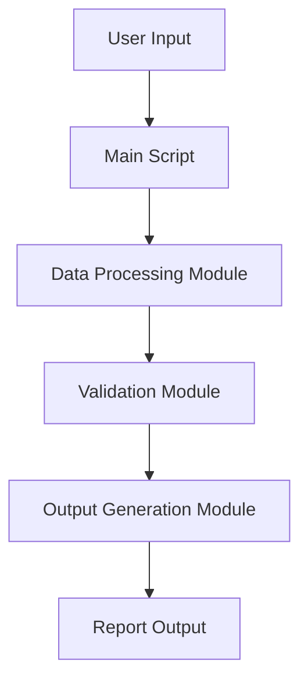

# Product Requirements Document (PRD) for Python Project

## 1. Introduction

### 1.1 Purpose
Describe the purpose of the Python project. Explain what problem it solves or what value it provides. For example, "This project aims to build a Python-based data processing tool to automate report generation for sales teams."

### 1.2 Scope
Define the boundaries of the project. Specify what is included and excluded. For example, "The project will include a command-line interface for data processing but will not include a graphical user interface in the initial release."

### 1.3 Audience
Identify the intended audience for the PRD, such as developers, product managers, or stakeholders. For example, "This document is intended for the development team and project stakeholders."

## 2. Project Overview

### 2.1 Objectives
List the high-level goals of the project. Use SMART criteria (Specific, Measurable, Achievable, Relevant, Time-bound). For example:
- Develop a Python script to process CSV files within 5 seconds for datasets up to 1 GB.
- Ensure compatibility with Python 3.8+.
- Deliver the first version by [specific date].

### 2.2 Success Metrics
Define how success will be measured. For example:
- Reduction in report generation time by 50%.
- 95% test coverage for all critical functions.
- User satisfaction score of 4/5 from internal stakeholders.

## 3. Functional Requirements

### 3.1 Features
List the core features of the Python project. For each feature, include:
- **Feature Name**: A short, descriptive name.
- **Description**: What the feature does and why it’s important.
- **Priority**: High, Medium, or Low.
- **Example**: 
  - **Feature**: CSV Data Parsing
  - **Description**: Parse CSV files to extract and validate data for report generation.
  - **Priority**: High

### 3.2 User Stories
Write user stories to describe how users will interact with the project. Use the format: "As a [user type], I want [functionality] so that [benefit]." For example:
- As a data analyst, I want to upload a CSV file so that I can generate a summary report automatically.

## 4. Technical Requirements

### 4.1 Technology Stack
Specify the technologies and tools to be used:
- **Programming Language**: Python 3.8+
- **Libraries/Frameworks**: List key libraries (e.g., pandas for data processing, pytest for testing).
- **Dependencies**: External APIs, databases, or services (e.g., SQLite for local storage).
- **Environment**: Development, testing, and production environments (e.g., Docker containers).

### 4.2 System Architecture
Describe the high-level architecture. For example:
- Modular Python scripts with a main entry point (e.g., `main.py`).
- Separation of concerns (e.g., data processing, validation, and output generation in separate modules).
- Include a simple diagram if applicable (e.g., using Mermaid syntax for markdown).

### 4.3 Performance Requirements
Define performance expectations, such as:
- Process datasets up to 1 GB in under 5 seconds.
- Handle up to 100 concurrent users (if applicable).

### 4.4 Security Requirements
Specify security considerations, such as:
- Input validation to prevent injection attacks.
- Secure handling of sensitive data (e.g., encryption for API keys).

## 5. Non-Functional Requirements

### 5.1 Usability
Describe usability goals, such as:
- Command-line interface with clear help messages (e.g., `python main.py --help`).
- Comprehensive documentation for setup and usage.

### 5.2 Scalability
Explain how the project will handle growth, such as:
- Modular design to allow easy addition of new features.
- Support for larger datasets in future versions.

### 5.3 Maintainability
Outline practices for code maintenance:
- Follow PEP 8 style guidelines for Python code.
- Use version control (e.g., Git) with clear commit messages.
- Include automated tests using pytest.

## 6. Development Plan

### 6.1 Milestones
List key milestones with timelines. For example:
- Week 1: Set up project structure and dependencies.
- Week 2: Implement core data processing logic.
- Week 4: Complete testing and documentation.

### 6.2 Resources
Identify required resources:
- **Team**: Python developers, QA engineers, project manager.
- **Tools**: IDE (e.g., VS Code), CI/CD pipeline (e.g., GitHub Actions).
- **Budget**: If applicable, include estimated costs.

## 7. Risks and Mitigation

List potential risks and mitigation strategies. For example:
- **Risk**: Dependency version conflicts.
- **Mitigation**: Use a virtual environment and pin dependency versions in `requirements.txt`.

## 8. Documentation and Support

### 8.1 Documentation
Specify documentation deliverables:
- README with setup instructions and usage examples.
- Inline code comments for complex logic.
- API documentation if applicable (e.g., using Sphinx).

### 8.2 Support Plan
Describe how the project will be supported post-launch:
- Bug tracking via GitHub Issues.
- Regular maintenance updates every 3 months.

## 9. Appendix

Include additional information, such as:
- Glossary of terms.
- References to external resources or standards (e.g., PEP 8, Python documentation).
- Mockups or wireframes if applicable.

---

## Best Practices for PRD Creation

1. **Clarity and Conciseness**: Use simple language and avoid jargon unless necessary. Keep sections short and focused.
2. **Stakeholder Alignment**: Share the PRD with all stakeholders early to gather feedback and ensure agreement.
3. **Version Control**: Store the PRD in a version-controlled repository (e.g., Git) to track changes.
4. **Iterative Updates**: Update the PRD as the project evolves, especially during agile development.
5. **Use Visuals**: Include diagrams or tables to clarify complex ideas, such as system architecture or feature prioritization.
6. **Tailor to Python Context**: Highlight Python-specific considerations, such as library choices, testing frameworks, and adherence to PEP standards.
7. **Define Success Early**: Clearly articulate success metrics to guide development and evaluation.