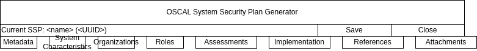

# oscal-processor
code for working with OSCAL catalogs and security plans

# Goals
1. Process a catalog and ssp to render a "filled out" document
2. Create a basic web-ui that can be run from within Docker such that:
   1. Docker can be run locally
   2. Mounts existing directory/files
   3. Can be accessed on localhost
   4. Renders a catalog with blanks
   5. Blanks can be edited
   6. Edits are saved to an SSP file
3. Create publisher plugins to output a catalog to formats such as:
   1. Confluence
   2. Wiki
   3. Notion
   4. Basic HTML/JS
   5. GitHub Pages
4. Publisher can be run via GitHub Actions

# Approach
* Create a PRD outlining the goals
* processor will come first, such that the files necessary for
  publishing are correctly created
* Basic HTML renderer
* GitHub Pages renderer
* Confluence Renderer

# Running the Local Server

To start the local FastAPI server for development:

1. Make sure you're running the right environment:
   ```bash
   $ pyenv shell 3.13.0
   ```

2. Make sure you have all dependencies installed:
   ```bash
   pip install -r requirements.txt
   ```

3. Start the server from the project root:
   ```bash
   uvicorn src.api.main:app --reload
   ```

4. Open your browser and go to:
   [http://localhost:8000](http://localhost:8000)

The web UI will be served from `static/index.html`. `/` currently returns `static/index_claude.html`.



## AI agents and new-machine setup

After cloning, start with [`agents/NEW_MACHINE.md`](agents/NEW_MACHINE.md). Coding agents should read [`agents/README.md`](agents/README.md).
